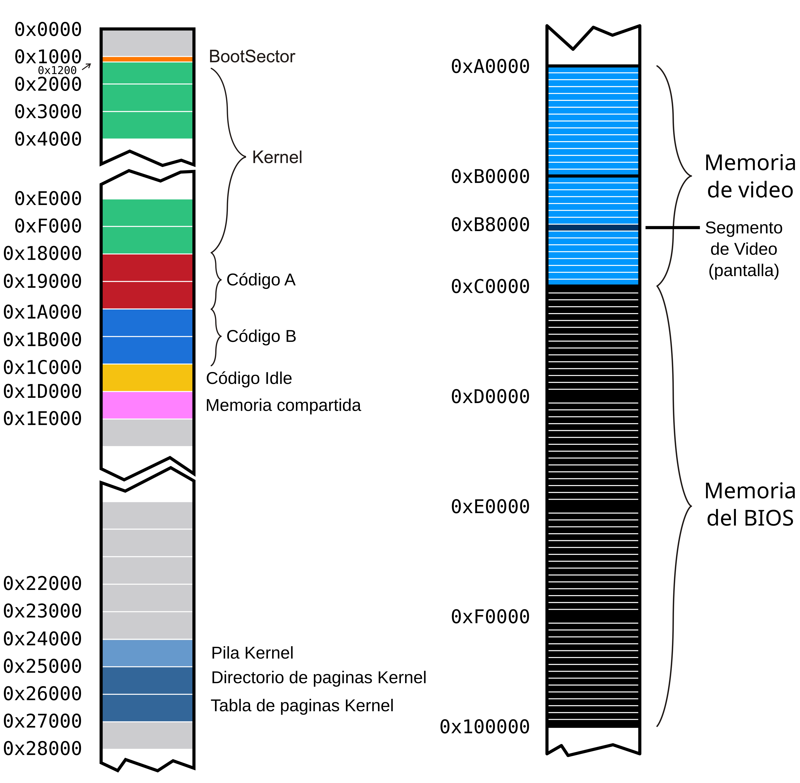
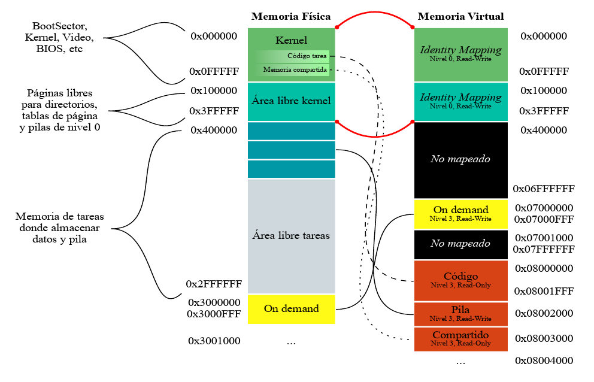

# System Programming: Tareas.

Vamos a continuar trabajando con el kernel que estuvimos programando en los talleres anteriores. La idea es incorporar la posibilidad de ejecutar algunas tareas específicas. Para esto vamos a precisar:

-   Definir las estructuras de las tareas disponibles para ser ejecutadas.

-   Tener un scheduler que determine la tarea a la que le toca ejecutar en un período de tiempo, y el mecanismo para el intercambio de tareas de la CPU.

-   Iniciar el kernel con una *tarea inicial* y tener una *tarea idle* para cuando no haya tareas en ejecución.

Recordamos el mapeo de memoria con el que venimos trabajando. Las tareas
que vamos a crear en este taller van a ser parte de esta organización de
la memoria:





## Archivos provistos

A continuación les pasamos la lista de archivos que forman parte del
taller de hoy junto con su descripción:

-   **Makefile** - encargado de compilar y generar la imagen del
    floppy disk.

-   **idle.asm** - código de la tarea Idle.

-   **shared.h** -- estructura de la página de memoria compartida

-   **tareas/syscall.h** - interfaz para realizar llamadas al sistema
    desde las tareas

-   **tareas/task_lib.h** - Biblioteca con funciones útiles para las
    tareas

-   **tareas/task_prelude.asm**- Código de inicialización para las
    tareas

-   **tareas/taskPong.c** -- código de la tarea que usaremos
    (**tareas/taskGameOfLife.c, tareas/taskSnake.c,
    tareas/taskTipear.c **- código de otras tareas de ejemplo)

-   **tareas/taskPongScoreboard.c** -- código de la tarea que deberán
    completar

-   **tss.h, tss.c** - definición de estructuras y funciones para el
    manejo de las TSSs

-   **sched.h, sched.c** - scheduler del kernel

-   **tasks.h, tasks.c** - Definición de estructuras y funciones para
    la administración de tareas

-   **isr.asm** - Handlers de excepciones y interrupciones (en este
    caso se proveen las rutinas de atención de interrupciones)

-   **task\_defines.h** - Definiciones generales referente a tareas

## Ejercicios

Antes de comenzar, vamos a actualizar el archivo `isr.asm` con algunas syscalls adicionales.

- Reemplazar el código de la `isr88` por
```
pushad
push eax
call tasks_syscall_draw
add esp, 4
popad
iret
```
Esta va a ser una syscall para que una tarea dibuje en su pantalla ¿Cuál es la convención de pasaje de parámetros para esta syscall?

- Verificar que su rutina de atención para las interrupciones del teclado sea funcionalmente igual a esta:
```
pushad
; 1. Le decimos al PIC que vamos a atender la interrupción
call pic_finish1
; 2. Leemos la tecla desde el teclado y la procesamos
in al, 0x60
push eax
call tasks_input_process
add esp, 4
popad
iret
```

- Verificar que la rutina de atención para los pagefault que escribieron en el taller anterior tenga esta forma (recuerden incluir la parte que implementaron para la página compartida a demanda):
```
;; Rutina de atención de Page Fault
;; -------------------------------------------------------------------------- ;;
global _isr14

_isr14:
	; Estamos en un page fault.
	pushad
    ; COMPLETAR: llamar rutina de atención de page fault, pasandole la dirección que se intentó acceder
    .ring0_exception:
	; Acá solo deberíamos llegar si ocurrió un page fault fuera del area compartida.
    call kernel_exception
    jmp $

    .fin:
	popad
	add esp, 4 ; error code
	iret
```
> No olviden comentar la macro `ISRE 14` para que la rutina no quede definida dos veces.

### Primera parte: Inicialización de tareas

**1.** Si queremos definir un sistema que utilice sólo dos tareas, ¿Qué
nuevas estructuras, cantidad de nuevas entradas en las estructuras ya
definidas, y registros tenemos que configurar?¿Qué formato tienen?
¿Dónde se encuentran almacenadas?

**2.** ¿A qué llamamos cambio de contexto? ¿Cuándo se produce? ¿Qué efecto
tiene sobre los registros del procesador? ¿Qué mecanismo provee el procesador para realizar el cambio de contexto? ¿Cuál vamos a usar en su lugar?

**3.** ¿Por qué es necesario cargar el registro **TR** si no vamos a usar ese mecanismo para el cambio de tareas? ¿Qué consideraciones deberíamos
tener cuando no tenemos tareas que ejecutar o se encuentran todas suspendidas?

**4.** ¿Qué hace el scheduler de un Sistema Operativo? ¿A qué nos referimos con que usa una política?

**5.** En un sistema de una única CPU, ¿cómo se hace para que los programas parezcan ejecutarse en simultáneo?

**6.** En **tss.c** se encuentra definida la TSS de la **Tarea Inicial**, que será la única de nuestro sistema. Ahora, vamos a agregar el *TSS Descriptor* correspondiente a esta tarea en la **GDT**.

a) Escriban el código del método ***tss_init*** de **tss.c** que
agrega la entrada a la **GDT** correspondiente al
descriptor de TSS de la tarea Inicial.

b) En **kernel.asm**, luego de habilitar paginación, agreguen una
llamada a **tss_init** para que efectivamente se
agregue a la **GDT**.

c) Correr el *qemu* y usar **info gdt** para verificar que el
***descriptor de tss*** de la tarea Inicial está
efectivamente cargada en la GDT.

**7.** Una vez configurada la tss de la **tarea Inicial**, debemos asegurarnos de que el procesador sepa dónde está para poder realizar cambios de nivel de privilegio. Completen lo necesario en **kernel.asm** para que cargue la tarea inicial. Recuerden que la primera vez tenemos que cargar el registro **TR** (Task Register) con la instrucción **LTR**.

Si obtienen un error, asegurense de haber proporcionado un selector de
segmento para la tarea inicial. Un selector de segmento no es sólo el
indice en la GDT sino que tiene algunos bits con privilegios y el *table
indicator*.

**8.** Una vez que el procesador comenzó su ejecución en la **tarea Inicial**, vamos a cambiar el contexto de ejecucuión para pasar a la **tarea Idle**. Esta tarea, definida en `idle.asm` e inicializada en `tasks_init()`, no es más que un loop infinito pensado para mantener ocupado el procesador cuando no hay tareas disponibles para correr. Para eso, vamos a implementar una función en `isr.asm` llamada `switch_to_usermode` cuya tarea será configurar el estado de la pila y de los registros de modo que, al retornar con la instrucción `iret`, el procesador cambie el nivel de privilegio a usuario e inicie la ejecución de la tarea idle. Para eso precisamos considerar: 
- Qué valores precisamos que tengan los registros de propósito general?
- Qué esquema de paginación debería estar en uso? (Asegúrense de haber inicializado previamente el directorio de páginas para la tarea idle).
- Cuál debería ser el estado de la pila del kernel?

**9.** Llamen a esta función en `kernel.asm` (no se olviden de importarla) y  debugueando verifiquen que el valor del registro **CR3** tiene el valor esperado con **creg**.

**10.** Nuestro objetivo es tener múltiples tareas activas en el sistema, que se turnen para ejecutarse. Para ello necesitamos que tener un espacio de memoria en el que guardemos el contexto de ejecución de las tareas para poder desalojarlas del procesador en cualquier punto de su ejecución y restaurarlas más adelante sin que las tareas se enteren. Si revisan `tasks.c` verán que este espacio ya está definido como un array de structs `task_t` definido para almacenar el contexto de ejecución de las tareas. Observen las funciones `create_task` y `tasks_init` y adapten lo implementado en el punto 8 para hacer uso de estas estructuras y funciones. Adapten  `switch_to_usermode` para que busque el estado inicial de la tarea idle en la entrada correspondiente del array de tareas.

### Segunda parte: Poniendo todo en marcha

Ahora nos gustaría que en cada interrupción de reloj se consulte al scheduler si corresponde realizar un cambio de tarea y, en caso afirmativo, lo haga.

**11.**  Para este TP la cátedra ha creado un scheduler que devuelve
la próxima tarea a ejecutar.

a)  En los archivos **sched.c** y **sched.h** se encuentran definidos
    los métodos necesarios para el Scheduler. Expliquen cómo funciona
    el mismo, es decir, cómo decide cuál es la próxima tarea a
    ejecutar.

b)  Modifiquen **kernel.asm** para llamar a la función
    ***sched_init*** luego de inicializar las tareas.

c)  Habrán visto que en `sched.c` se define la variable `current_task` que almacena el id de la tarea que corre actualmente. Modifiquen la rutina de atención de la interrupción del reloj para que ejecute `sched_next_task`.

**12.**  Si adaptamos `switch_to_usermode` para que lea `current_task` y en base a su valor determine qué contexto leer del array de tareas, podremos llamarla al final de la interrupción de reloj para que realice el cambio de contexto a la siguiente tarea (o no) de acuerdo al efecto de `sched_next_task`. Noten que cómo `current_task` se inicializa en `0`, esta modificación no debería afectar el llamado a `switch_to_usermode` desde `kernel.asm`.

**13.** Ya solo nos falta una parte para que las tareas puedan correr concurrentemente: guardar el contexto de la tarea al momento en que fue interrumpida por el reloj. Para ello, implementaremos `save_current_task_context` en `isr.asm` y la llamaremos ni bien comienza la rutina de atención del reloj. Esta función deberá actualizar el elemento correspondiente a la tarea actual en el array de tareas con los valores actuales del procesador. **Cuidado!** Cualquier cosa que hagan que modifique registros estará pisando contexto propio de la tarea, asegurense de resguardar aquello que vayan a pisar y luego leerlo de allí cuando vayan a actualizar el campo correspondiente en el struct de la tarea.

Llegado este punto deberían:
- Haber cargado el selector de tss de la tarea inicial en TR.
- Haber inicializado el scheduler con `sched_init` y las estructuras de las tareas con `tasks_init`.
- Haber implementado la función `switch_to_usermode` de modo que al llamarla cargue en el procesador el contexto guardado de la tarea actual y prepare la pila para reanudar su ejecución tras ejecutar `iret`.
- Haber implementado la función `save_current_task_context` que guarda el contexto de la tarea actual en su elemento correspondiente en el array de tareas.
- Haber modificado la rutina de atención del reloj para que guarde el contexto de la tarea actual, pedirle al scheduler que determine qué tarea debe ejecutarse a continuación y que retome la ejecución de la tarea correspondiente.


### Tercera parte: Tareas? Qué es eso?

**14.** Con todo eso implementado correctamente, deberían poder correr el sistema y ver tres tareas corriendo en simultáneo con las que pueden interactuar. Observen el código de estas superficialmente (se encuentran en la carpeta `src/tareas`).

a) ¿Qué mecanismos usan para comunicarse con el kernel?

b) ¿Por qué creen que no hay uso de variables globales? Piensen en el espacio de memoria que precisarían ¿Qué pasaría si una tarea intentase escribir en él con nuestro sistema?

c) La interrupción de reloj es fundamental para la conmutación de tareas. Por defecto, esta interrupción se genera cada 65536 pulsos de un clock de 1193182Hz (ciclos por segundo) llamado PIT (Programmable Interval Timer), es decir, llega la interrupción a una tasa de 1193182 Hz / 65536 = 18,206 Hz. Pero se puede configurar escribiendo el tamaño del intervalo (cantidad de pulsos entre interrupciones) en el puerto 0x40 (16 bits). 65536 no es un valor representable en 16 bits pero se lo puede alcanzar usando 0 para representarlo, aprovechando que este no es un divisor válido. De ahí en adelante los valores se interpretan de forma directa (1 = 1, 2 = 2, ..., 65535 = 65535).

a. Escribir en el timer (puerto 0x40) el valor de cuenta para que las interrupciones lleguen al doble de velocidad.
Tener en cuenta que el bus es de 8 bits, por lo que se deben hacer 2 escrituras consecutivas (parte baja -- parte alta respectivamente).

b. ¿Cómo harían para que la impresión del caracter giratorio sea una vez por segundo?

c. ¿Qué pasaría si llevamos la frecuencia de las interrupciones al máximo?

d. Establezcan una frecuencia de interrupción que permita el funcionamiento fluido de las tareas.


**15.** Observen **tareas/task_prelude.asm**. El código de este archivo
se ubica al principio de las tareas.

a. ¿Por qué la tarea termina en un loop infinito?

b. \[Opcional\] ¿Qué podríamos hacer para que esto no sea necesario?

### Cuarta parte: Hacer nuestra propia tarea

Ahora programaremos nuestra tarea. La idea es disponer de una tarea que
imprima el *score* (puntaje) de todos los *Pongs* que se están
ejecutando. Para ello utilizaremos la memoria mapeada *on demand* del
taller anterior.

#### Análisis:

**16.** Analicen el *Makefile* provisto. ¿Por qué se definen 2 "tipos"
de tareas? ¿Como harían para ejecutar una tarea distinta? Cambien la
tarea S*nake* por una tarea *PongScoreboard*.

**17.** Mirando la tarea *Pong*, ¿En que posición de memoria escribe
esta tarea el puntaje que queremos imprimir? ¿Cómo funciona el mecanismo
propuesto para compartir datos entre tareas?

#### Programando:

**18.** Completen el código de la tarea *PongScoreboard* para que
imprima en la pantalla el puntaje de todas las instancias de *Pong* usando los datos que nos dejan en la página compartida.

**19.** \[Opcional\] Resuman todas las estructuras vistas
desde la parte 1 a 4 de este TP. Escriban el funcionamiento general de
segmentos, interrupciones, paginación y tareas en los procesadores
Intel. ¿Cómo interactúan las estructuras? ¿Qué configuraciones son
fundamentales a realizar? ¿Cómo son los niveles de privilegio y acceso a
las estructuras?

**20.** \[Opcional\] ¿Qué pasa cuando una tarea dispara una
excepción? ¿Cómo podría mejorarse la respuesta del sistema ante estos
eventos?
